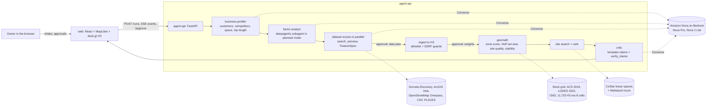

# Siteline

Siteline tells any business where in Houston to open its next location: a laundromat, a tutoring center, a coffee shop
or a medical practice.

The owner describes the business and its customers. An agent then:
1. Works out who the customers are, who competes, and what makes a new location succeed for *this* business.
2. Finds public data to measure each factor, including data our stock layer doesn't have, such as OpenStreetMap competitors or CDC health measures.
3. Asks the owner to approve the data plan and the weights.

Deterministic Python scores every H3 hexagon in Harris, Fort Bend and Montgomery counties. It estimates how many
customers each site would win (Huff model) after competitors and the owner's other locations take their share. Real
CoStar spaces in the best zones are ranked by customers won and rent per customer won. A critic checks every number
in every claim against its source before the top 10 is shown with citations.

**The rule that never bends:** the model decides *what* to compute, and Python computes *every* number. Claim text is
built from Python templates filled with stored values; the model only chooses and orders the claims. `verify_claims`
recomputes each number before the report is marked verified.

Built at HackPrinceton Fall 2026. Main track: **Business + Enterprise**.

## Architecture



- **Agent modes.** `AGENT_MODE=scripted` has Python order the steps while the model reasons inside each one. `planned` lets a deepagents orchestrator plan the factor step through a validated `save_factors` tool. Both stream the same events.
- **Backends.** `AGENT_BACKEND=mock` serves fixtures with no data needed. `local` uses `data/raw` and `data/derived` parquet files plus the CoStar files.
- **Approvals.** A run pauses for the owner twice: after the data plan and after the weights.
- **Recorded runs.** `scripts/record_golden.py` saves a live run to `data/golden/`, and agent-api replays it with the same pauses. The demo never depends on a live API.

## Run it

Fixture mode needs no keys and no data:
```bash
python -m venv .venv && .venv/bin/pip install -r services/agent/requirements.txt -r services/agent/requirements-dev.txt
make fixtures
cd web && npm install && npm run dev          # http://localhost:5173, "Recorded run"
```

Live mode needs AWS credentials in the default chain (`~/.aws`; never in `.env`) with Bedrock access to Nova, plus the
`data/raw` files:
```bash
cp .env.example .env                           # AGENT_BACKEND=local, AGENT_MODE=scripted, FIXTURE_MODE=0, VITE_FIXTURE_MODE=0
PYTHONPATH=. .venv/bin/python scripts/check_bedrock.py
PYTHONPATH=. .venv/bin/python scripts/build_general_stock.py      # ACS + LODES -> data/derived/general_stock.parquet
PYTHONPATH=. .venv/bin/python -m scripts.build_sector_stock        # ACS poverty/SNAP + USDA food access -> sector_stock.parquet
make run-agent                                 # :8000
make run-web                                   # :5173, "Live agent"
```

Checks:
```bash
make test                                                          # Python unit tests
cd web && npm run typecheck && npm test
PYTHONPATH=. .venv/bin/python -m services.agent.evals.run_evals --mode scripted    # factor-analyst evals, judged by Nova 2 Lite
PYTHONPATH=. .venv/bin/python scripts/e2e.py --live-only --case laundromat          # full live run against agent-api
PYTHONPATH=. .venv/bin/python scripts/e2e.py --replay-only --golden laundromat      # replay a recorded run
```

Deploy: [infra/README.md](infra/README.md). It runs one EC2 box with Caddy for HTTPS and a site password in front of agent-api, an IAM instance role for Bedrock, and IMDSv2 required.

## Data sources

| Data | Source | Used for |
|---|---|---|
| Population by age, income, insurance, language (tracts) | [Census ACS 5-year](https://www.census.gov/data/developers/data-sets/acs-5year.html) | stock grid |
| Renters, units in structure, vehicles available, households (2024 tracts) | [ACS summary files](https://www.census.gov/programs-surveys/acs/data/summary-file.html) | demand for any business |
| Poverty (100/185/200%), children and seniors in poverty, SNAP households, children under 5 (2024 tracts) | [ACS summary files](https://www.census.gov/programs-surveys/acs/data/summary-file.html) C17002, B17020, B22003, B01001 | nonprofit, food bank and child care packs |
| Low-income, low-food-access tracts (2025 SNAP retailers, 2020 tracts) | [USDA ERS Food Access Research Atlas](https://www.ers.usda.gov/data-products/food-access-research-atlas/) | food bank pack |
| Jobs by workplace (2022 blocks) | [LEHD LODES8](https://lehd.ces.census.gov/data/) | daytime workers |
| Clinicians by specialty | [CMS Doctors and Clinicians](https://data.cms.gov/provider-data/dataset/mj5m-pzi6) | healthcare competitors |
| Hospitals | [CMS Hospital General Information](https://data.cms.gov/provider-data/dataset/xubh-q36u) | healthcare factors |
| Competitor locations for any business | [OpenStreetMap](https://www.openstreetmap.org/copyright) via the Overpass API, fetched live | Huff competitors |
| Health measures by tract | [CDC PLACES](https://data.cdc.gov/d/yjkw-uj5s), found live by a scout | e.g. arthritis prevalence for orthopedics |
| Other open datasets | [Socrata Discovery API](https://dev.socrata.com/docs/other/discovery) and [ArcGIS Hub](https://hub.arcgis.com/) search, found live | factors not in the stock grid |
| Lease spaces, rents, floors, parking, Matterport model ids | CoStar (hackathon kit) | site candidates |
| Tract geocoding of the owner's locations | [Census geocoder](https://geocoding.geo.census.gov/geocoder/) | existing sites in Huff |

CoStar data and anything derived from it stay in `data/` and are never committed. Fixture sites in `fixtures/` are
invented.

## How AI was used

- **Building it.** Claude Code (Claude Opus) wrote the code: contracts, agent pipeline, geomath, ingestion and its SSRF guards, critic, web app, tests, evals and infra. The team set direction, chose data and checked results.
- **Inside the product.** Amazon Nova on Bedrock through LangChain `ChatBedrockConverse`:
  - **Nova Pro** runs the business-profiler, the factor-analyst, the dataset-scouts' choices and the critic's claim selection.
  - **Nova 2 Lite** judges the evals.
  - Every model output is structured and validated by Python against real feature ids, columns and contracts before it is used.
  - No model writes a number the user sees.
- **Cost control.** An LLM response cache, a per-run call budget (`LLM_MAX_CALLS_PER_RUN`), token and cost logging per call in `runs/runs.db`, and a shared rate limiter with adaptive retries. A full live run costs a few cents.

## Track notes

- **Business + Enterprise.** Any business types its own description; nothing is hard-coded per industry. The result is a decision a business can act on: which real space to lease, how many customers it would win, and the annual rent per customer won.
- **CoStar.** CoStar spaces are the candidates:
  - Each card shows the space's asking rent, size, floor and parking, plus a Matterport 3D tour link when the building has one.
  - Spaces are filtered by the CoStar space uses that fit the business and de-duplicated by building.
- **LangChain deepagents.** In `planned` mode a deepagents orchestrator (LangGraph `create_agent`) plans with a factor-analyst subagent and a validated tool. Runs are traced with LangSmith when `LANGSMITH_API_KEY` is set.
- **Peri.** The customer story is Dr. Rahul Deshmukh's orthopedic practice:
  - In the orthopedic run, a scout finds CDC PLACES arthritis prevalence live and ingests it.
  - That data changes the ranking, and the claims cite it.
- **Amazon.** All reasoning runs on Amazon Nova through Bedrock, with credentials from the default chain (never in code). The run meter in the app shows each run's model calls, tokens and cost. An EC2 deploy setup is in `infra/`; the hackathon's AWS account allows Bedrock only, so the demo runs on a laptop.

## Limits

- For businesses other than healthcare, the headline is *reach*: the target households, workers or residents a site would capture after competitors. It is not a sales forecast, because no visit rates are invented.
- OpenStreetMap undercounts some competitor types, which inflates reach. Each report says so.
- Distances are straight-line, and catchment size depends on the trip type: neighborhood, local or destination.
