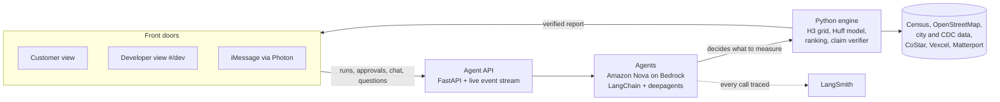

# Siteline

**Siteline tells any business where in Houston to open its next location, and shows the evidence behind every number.**

A laundromat, a tutoring center, a pet groomer or a medical practice describes itself in plain words. Siteline works out
who its customers are, who it competes with and what makes a location succeed for *that* business. It then scores
every neighborhood in the Houston area and ranks real lease listings by how many new customers each one would win.

Built at HackPrinceton Fall 2026 by Archit, Gaurav, Jayan and Parth. Main track: **Business + Enterprise**.

---

## What the owner does

| Step | What happens |
|---|---|
| **1. Describe the business** | Chat in your own words: *"a pet grooming salon for dog owners in apartments, about 1,200 sq ft"*. Nothing is hard-coded per industry. |
| **2. OK the data** | The agent lists the public datasets it wants to use, for example OpenStreetMap competitors or CDC health measures. Nothing is downloaded until you say yes. |
| **3. OK the priorities** | It shows what it will weigh most, such as renters nearby or few competitors. Accept it or move the sliders. |
| **4. Get ranked spaces** | The best real lease listings appear on a map, each with the customers in reach, rent per customer won, parking, community need and a 3D tour. Then ask follow-up questions such as *"which is cheapest per customer?"* |

Steps 2 and 3 are the human checkpoints: the agent never fetches new data or fixes its priorities without a yes.

## How it works



Every run makes the same nine stops, and the developer view shows each one live:

| # | Stop | Who does it |
|---|---|---|
| 1 | Understand the business and its customers | Agent: profiler |
| 2 | Reason about what makes a location succeed | Agent: factor analyst |
| 3 | Find data for factors we have no data for | Agents: dataset scouts, in parallel |
| 4 | Approve the data plan | **The owner** |
| 5 | Weigh what matters most | Factor analyst proposes, **the owner** approves |
| 6 | Find real spaces in the top zones | Python (CoStar listings) |
| 7 | Rank spaces by new customers won | Python (Huff model) |
| 8 | Inspect the top spaces from above and inside | Agent: site inspector |
| 9 | Write and verify the report | Agent: critic, checked by Python |

### The agents

All reasoning runs on Amazon Nova through Bedrock. Smart roles use **Nova Pro** and fast roles use **Nova 2 Lite**.

| Agent | Model | What it does |
|---|---|---|
| **Intake** | Nova Pro | Chats with the owner and turns the description into a business profile: customers, size and budget. Python clamps every value, and the agent's replies can't invent numbers. |
| **Profiler** | Nova Pro | Works out who the customers are and which Census groups count them, for example renter households or children under 18. |
| **Factor analyst** | Nova Pro | Lists what makes a location succeed for this business, then proposes how much each factor should weigh, with a reason for each. |
| **Dataset scouts** | Nova 2 Lite | One per factor with no data yet, running in parallel. Searches allowlisted public catalogs and proposes a dataset to ingest. |
| **Orchestrator** | Nova Pro | In `planned` mode, a deepagents agent writes its own plan and hands work to a factor-analyst sub-agent. The default `scripted` mode follows the nine stops. |
| **Site inspector** | Nova Pro | A deepagents agent that checks the top five buildings: reads the CoStar listing, counts parked cars on the Vexcel aerial and reads the Matterport 3D scan. |
| **Critic** | Nova Pro | Picks and orders the report's claims. Each claim is filled in from a Python template and checked before it ships. |
| **Concierge** | Nova Pro | Answers follow-up questions. The model only classifies the question; Python looks the answer up in the verified report. |
| **Judge** | Nova 2 Lite | Used only in evals. Grades the factor analyst's reasoning on seven example businesses. |

### The rule that never bends

**The model decides *what* to measure. Python computes *every* number.**

Language models are good at judgment and unreliable at arithmetic, so no model ever writes a number the user sees:
- Claims are built from Python templates filled with stored values.
- Each claim points at an evidence reference: a feature, a model result, a listing, an inspection or a community figure.
- `verify_claims` recomputes every number. A claim that doesn't match its source is dropped, and the report is marked verified only when every claim passes.

### How a space is scored

1. **Count the customers.** The Houston area (Harris, Fort Bend and Montgomery counties) is split into 11,720 H3 hexagons. Each one gets a count of this business's core customers from Census data, for example renter households for a laundromat.
2. **Map the competition.** Competitors come from OpenStreetMap, city data and, for healthcare, CMS. The owner's existing locations are added too. Each one pulls customers toward itself.
3. **Share out the customers.** A Huff gravity model splits each hexagon's customers among nearby options by distance. The catchment is a 10, 20 or 30 minute trip, depending on the business. A quarter of customers are assumed to choose none of them, so reach is never inflated.
4. **Rank the real spaces.** CoStar listings that fit the business's space type and size are ranked by customers won, the weighted factors and rent per customer won. Changing the weights re-ranks instantly with no model call, and the report shows how stable the top picks are.

### Looking at the building and the neighborhood

- **Site inspector.** It combines three views of the same address:
  - **CoStar:** the listing's size, rent, listed parking and lease status.
  - **Vexcel:** parked cars counted within 60 m on the aerial image, compared against the listed parking. A lot that is 85% or more full is flagged as possibly tight at peak.
  - **Matterport:** the building's 3D scan, with floors, rooms and scanned area, plus a 3D tour link.

  If a check has no data, it says so instead of guessing.
- **Community need.** For the top sites it shows who lives in the catchment: households without a car, renters, people on Medicaid and households in lower-income tracts. A clinic or laundromat can see where it is needed, not just where it is profitable.

### Three ways to use it

| | For | What you see |
|---|---|---|
| **Customer view** (default page) | Business owners | A chat to describe the business, two yes/no cards, then a map with the top 3 spaces, a "See all" list, a details drawer and an Ask box. |
| **Developer view** (`#/dev`) | Judges, analysts, power users | The live run line with parallel scouts, the full approval panel, a ranked table with "Tune weights", factors, sources, a cost meter and a LangSmith Trace link. |
| **iMessage** (Photon 2.0) | Anyone with a phone | Text a description, reply YES or NO to the approvals, get the top spaces back as a text and ask follow-up questions. |

Both web views share one run, so switching views mid-run loses nothing.

## Run it

**Offline demo: no keys and no data needed.**
```bash
python -m venv .venv && .venv/bin/pip install -r services/agent/requirements.txt -r services/agent/requirements-dev.txt
make fixtures
cd web && npm install && npm run dev          # http://localhost:5173
```

**Live mode.** You need:
- AWS credentials in the default chain (`~/.aws`, never in `.env`) with Bedrock access to Nova.
- The `data/raw` files.
```bash
cp .env.example .env                           # AGENT_BACKEND=local, AGENT_MODE=scripted, FIXTURE_MODE=0, VITE_FIXTURE_MODE=0
PYTHONPATH=. .venv/bin/python scripts/check_bedrock.py
PYTHONPATH=. .venv/bin/python scripts/build_general_stock.py      # ACS + LODES -> data/derived/general_stock.parquet
make run-agent                                 # agent API on :8000
make run-web                                   # web app on :5173
```

Optional keys go in `.env`:
- `LANGSMITH_API_KEY`: tracing.
- `VEXCEL_API_KEY`: aerial imagery and parked-car counts.
- `MATTERPORT_API_KEY` and `MATTERPORT_API_TOKEN`: 3D scans.

**iMessage.** Put `PHOTON_API_KEY` and `PHOTON_PROJECT_ID` in `.env`. Optionally set `PHOTON_ALLOWED_SENDERS` to limit who can text it. Then run:
```bash
make run-photon
```

**Recorded runs.** `scripts/record_golden.py` saves a finished live run to `data/golden/`, and the agent API replays it with the same approval pauses, so a demo never depends on a live API.

**Checks:**
```bash
make test                                                          # Python unit tests
cd web && npm run typecheck && npm test                            # web types and tests
PYTHONPATH=. .venv/bin/python -m services.agent.evals.run_evals --mode scripted    # factor-analyst evals, judged by Nova 2 Lite
PYTHONPATH=. .venv/bin/python scripts/e2e.py --live-only --case laundromat          # full live run against the agent API
PYTHONPATH=. .venv/bin/python scripts/e2e.py --replay-only --golden laundromat      # replay a recorded run
```

Results of the last full check (Nov 15, 2026):

| Check | Result |
|---|---|
| Python unit tests | 105 passed |
| Factor-analyst evals | 40/40 checks across 7 businesses |
| Live end-to-end runs (laundromat, orthopedic group, tutoring center) | 3/3 verified |
| Cost of a live run | $0.007 to $0.04 |
| Time for a live run | 8 to 25 seconds |

**Deploy.** See [infra/README.md](infra/README.md). It runs one EC2 box with:
- Caddy for HTTPS and a site password in front of the agent API;
- an IAM instance role for Bedrock;
- IMDSv2 required.

## Project layout

| Folder | What's in it |
|---|---|
| `services/agent/` | The agent API (FastAPI) and everything behind it: the pipeline, intake, profiler, factor analyst, scouts, site inspector, critic and concierge. |
| `services/agent/tools/` | The Python engine: geomath (scoring, Huff model, community need), ingestion with SSRF guards, search and weights. |
| `services/photon/` | The iMessage agent on Photon 2.0. |
| `services/geo/`, `services/sites/` | Placeholders for splitting geo and site search into their own services. Today both run inside `services/agent/`. |
| `web/` | The React + Vite + TypeScript app: a MapLibre + deck.gl H3 map, the customer view and the developer view. |
| `contracts/` | Shared data models (Pydantic), exported to JSON Schema and TypeScript types (`make types`). |
| `catalog/`, `packs/` | The curated catalog of Houston datasets, and factor packs for general and healthcare businesses. |
| `evals/` | Seven example businesses used to grade the factor analyst. |
| `fixtures/` | A small invented run and grid for the offline demo and tests. |
| `scripts/` | The Bedrock check, data build, end-to-end tests and recording of golden runs. |
| `infra/` | Docker, Caddy and EC2 setup. |
| `docs/` | Design notes and the team handoff, including the demo script. |

## Data sources

| Data | Source | Used for |
|---|---|---|
| Population by age, income, insurance, language (tracts) | [Census ACS 5-year](https://www.census.gov/data/developers/data-sets/acs-5year.html) | stock grid |
| Renters, units in structure, vehicles available, households (2024 tracts) | [ACS summary files](https://www.census.gov/programs-surveys/acs/data/summary-file.html) | demand for any business |
| Jobs by workplace (2022 blocks) | [LEHD LODES8](https://lehd.ces.census.gov/data/) | daytime workers |
| Clinicians by specialty | [CMS Doctors and Clinicians](https://data.cms.gov/provider-data/dataset/mj5m-pzi6) | healthcare competitors |
| Hospitals | [CMS Hospital General Information](https://data.cms.gov/provider-data/dataset/xubh-q36u) | healthcare factors |
| Competitor locations for any business | [OpenStreetMap](https://www.openstreetmap.org/copyright) via the Overpass API, fetched live | Huff competitors |
| Health measures by tract | [CDC PLACES](https://data.cdc.gov/d/yjkw-uj5s), found live by a scout | e.g. arthritis prevalence for orthopedics |
| Other open datasets | [Socrata Discovery API](https://dev.socrata.com/docs/other/discovery) and [ArcGIS Hub](https://hub.arcgis.com/) search, found live | factors not in the stock grid |
| Lease spaces, rents, floors, parking, Matterport model ids | CoStar (hackathon kit) | site candidates |
| Aerial imagery and parked-car detection | Vexcel (hackathon kit) | site inspector |
| 3D building scans | Matterport (hackathon kit) | site inspector, 3D tours |
| Tract geocoding of the owner's locations | [Census geocoder](https://geocoding.geo.census.gov/geocoder/) | existing sites in Huff |

## Sponsor tracks

- **Business + Enterprise.** Any business types its own description, with nothing hard-coded per industry. The result is a decision a business can act on: which real space to lease, how many customers it would win and the annual rent per customer won.
- **CoStar.** The site inspector uses all three layers for the same address and gets something from combining them. Parked cars counted on the Vexcel aerial only mean something next to the CoStar listing's parking, and the Matterport scan shows the inside of a building the owner hasn't visited. CoStar spaces are the candidates, filtered by the space uses that fit the business and de-duplicated by building.
- **Amazon.** All nine agent roles run on Amazon Nova through Bedrock (Nova Pro and Nova 2 Lite), with credentials from the default chain and never in code. The run meter shows each run's model calls, tokens and cost.
- **LangChain deepagents.** The site inspector is a deepagents agent that runs on every search: it plans which buildings to check and which tools to call. In `planned` mode, the orchestrator is a deepagents agent too, with a factor-analyst sub-agent and a validated `save_factors` tool. Every run is traced in LangSmith.
- **Photon.** Siteline runs on iMessage (`services/photon/agent.py`): text a business, approve by replying YES, get the top spaces and ask follow-up questions. It only answers direct threads, keeps one conversation per sender, supports a sender allowlist and rate-limits each sender.
- **Peri.** The customer story is Dr. Rahul Deshmukh's orthopedic practice. In the orthopedic run, a scout finds CDC PLACES arthritis prevalence live and ingests it, the data changes the ranking, and the claims cite it.

## Security and data handling

- **Human approval** is required before any new data is fetched and before the weights are final.
- **Safe fetching:** the agent can download only from allowlisted public hosts, with SSRF guards on every request.
- **Limits:**
  - the chat endpoints are rate-limited and capped on concurrent requests;
  - request bodies are capped at 512 KB;
  - a production deploy caps live runs and puts a password on the site.
- **Private data stays private:**
  - CoStar data and anything derived from it stay in `data/` and are never committed;
  - the fixture sites in `fixtures/` are invented;
  - keys live only in the gitignored `.env`;
  - AWS credentials come from the default credential chain only.

## Limits

- For businesses other than healthcare, the headline is *reach*: the target households, workers or residents a site would capture after competitors. It is not a sales forecast, because no visit rates are invented.
- OpenStreetMap undercounts some competitor types, which inflates reach. Each report says so.
- Distances are straight-line, and catchment size depends on the trip type: neighborhood, local or destination.
- A Vexcel parked-car count is a snapshot from when the image was taken, not a measure of peak demand.

## How AI was used

- **Building it.** Claude Code (Claude Opus) wrote most of the code: contracts, agent pipeline, geomath, ingestion and its SSRF guards, critic, web app, tests, evals and infra. The team set direction, chose data and checked results.
- **Inside the product.** Amazon Nova on Bedrock, through LangChain `ChatBedrockConverse`:
  - **Nova Pro** runs intake, the profiler, the factor analyst, the orchestrator, the site inspector, the critic and the concierge.
  - **Nova 2 Lite** runs the dataset scouts and judges the evals.
  - Every model output is structured and validated by Python against real feature ids, columns and contracts before it is used.
- **Cost control.**
  - An LLM response cache and a per-run call budget (`LLM_MAX_CALLS_PER_RUN`).
  - Token and cost logging for every call in `runs/runs.db`.
  - A shared rate limiter with adaptive retries.
